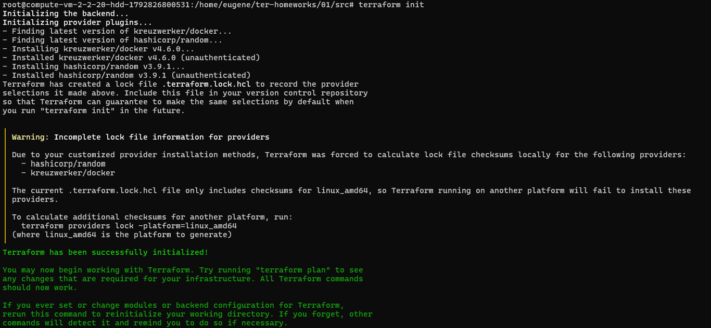
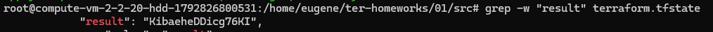
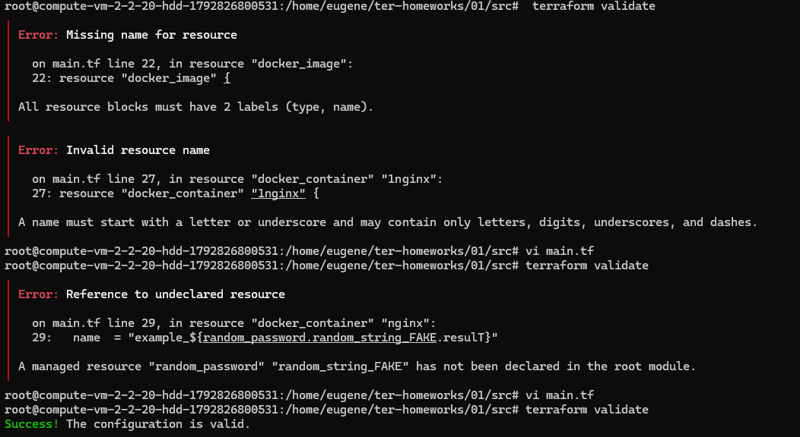
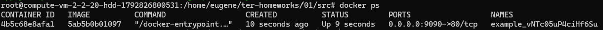
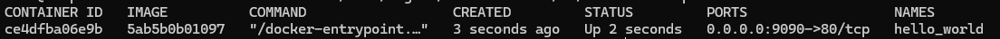
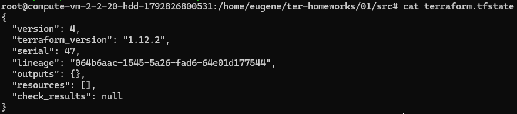
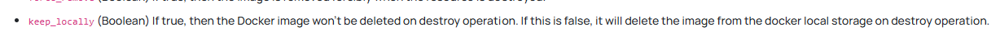
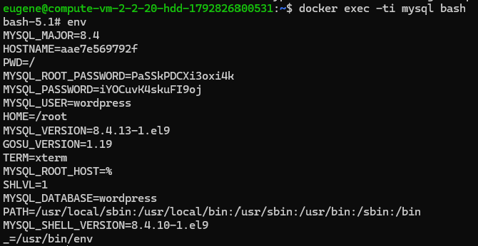
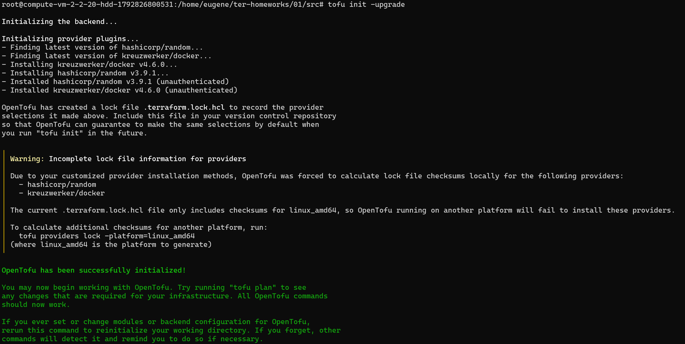

# Домашнее задание к занятию "`Введение в Terraform`" - `Поздникин Евгений`


### Инструкция по выполнению домашнего задания

   1. Сделайте `fork` данного репозитория к себе в Github и переименуйте его по названию или номеру занятия, например, https://github.com/имя-вашего-репозитория/git-hw или  https://github.com/имя-вашего-репозитория/7-1-ansible-hw).
   2. Выполните клонирование данного репозитория к себе на ПК с помощью команды `git clone`.
   3. Выполните домашнее задание и заполните у себя локально этот файл README.md:
      - впишите вверху название занятия и вашу фамилию и имя
      - в каждом задании добавьте решение в требуемом виде (текст/код/скриншоты/ссылка)
      - для корректного добавления скриншотов воспользуйтесь [инструкцией "Как вставить скриншот в шаблон с решением](https://github.com/netology-code/sys-pattern-homework/blob/main/screen-instruction.md)
      - при оформлении используйте возможности языка разметки md (коротко об этом можно посмотреть в [инструкции  по MarkDown](https://github.com/netology-code/sys-pattern-homework/blob/main/md-instruction.md))
   4. После завершения работы над домашним заданием сделайте коммит (`git commit -m "comment"`) и отправьте его на Github (`git push origin`);
   5. В личном кабинете прикрепите и отправьте ссылку на решение в виде md-файла в вашем Github.
   6. Любые вопросы по выполнению заданий спрашивайте в разделе “Вопросы по заданию” в личном кабинете.
   
Желаем успехов в выполнении домашнего задания!
   
### Дополнительные материалы, которые могут быть полезны для выполнения задания

1. [Руководство по оформлению Markdown файлов](https://gist.github.com/Jekins/2bf2d0638163f1294637#Code)

---

Подготовка 


Установка 


<details>
  <summary>Установка и настройка </summary>
Установка 
   
```bash
wget https://mirror.selectel.ru/3rd-party/hashicorp-releases/terraform/1.12.2/terraform_1.12.2_linux_amd64.zip
unzip terraform_1.12.2_linux_amd64.zip -d .
sudo mv terraform /usr/local/bin/
# terraform -version
Terraform v1.12.2
```
Настройка terraform
   
```bash
cat <<EOF > ~/.terraformrc
provider_installation {
  network_mirror {
    url     = "https://terraform-mirror.yandexcloud.net/"
    include = ["registry.terraform.io/*/*"]
  }
  direct {
    exclude = ["registry.terraform.io/*/*"]
  }
}
EOF
```

Настройка tofu

```
rm -f ~/.tofurc ~/.terraformrc && cat << 'EOF' > ~/.tofurc
provider_installation {
  network_mirror {
    url     = "https://terraform-mirror.yandexcloud.net/"
    include = ["registry.opentofu.org/*/*", "registry.terraform.io/*/*"]
  }
}
EOF
```
</details>


### Задание 1
1. Перейдите в каталог [src](https://github.com/netology-code/ter-homeworks/tree/main/01/src). Скачайте все необходимые зависимости, использованные в проекте.

После успешно выполненной установки и предподготовки нужно перейти в директорию с нашим проектом и выполнить команду `terraform init` он скачает нужные провайдеры указнные у нас в проекте 


2. Изучите файл .gitignore. В каком terraform-файле, согласно этому .gitignore, допустимо сохранить личную, секретную информацию?(логины,пароли,ключи,токены итд)

Судя по .gitignore таким является `personal.auto.tfvars`

`personal.auto.tfvars` —  Используется для хранения значений переменных, которые автоматически загружаются при выполнении команд terraform plan, terraform apply или terraform init.

файлы .tfvars по умолчанию включены в стандартные шаблоны .gitignore для Terraform, хранение секретов (токенов, паролей, идентификаторов облака) в personal.auto.tfvars считается безопасной практикой. Файл игнорируется Git и не будет случайно опубликован в публичном репозитории.


3. Выполните код проекта. Найдите в state-файле секретное содержимое созданного ресурса random_password, пришлите в качестве ответа конкретный ключ и его значение.

С помощью `grep` ищу значение  `result` в файле `terraform.tfstate`
   


4. Раскомментируйте блок кода, примерно расположенный на строчках 29–42 файла main.tf. Выполните команду terraform validate. Объясните, в чём заключаются намеренно допущенные ошибки. Исправьте их.

Вот ряд ошибок которые возникли при проверке командой `terraform validate`


Cообщения очень понятные и информативные, для их понимания не обязательно идти в интернет или документацию а достаточно лишь иметь базовое понимание английского языка.

Подробнее по ошибкам: 

1. Не найдено имя ресурса. У каждого ресурса должно быть 2 подписи тип  и имя. И действительно второе у нас пропущено, дописываем.   

```
│ Error: Missing name for resource
│
│   on main.tf line 22, in resource "docker_image":
│   22: resource "docker_image" {
│
│ All resource blocks must have 2 labels (type, name).
```
2. Имя не проходит валидацию. Ниже описаны правила по которым следует именовать ресурсы. Такие правила действуют во многих языках программирования а не прихоть терраформ. 
Следуем рекомендациям.

```
│ Error: Invalid resource name
│
│   on main.tf line 27, in resource "docker_container" "1nginx":
│   27: resource "docker_container" "1nginx" {
│
│ A name must start with a letter or underscore and may contain only letters, digits, underscores, and dashes.
```


3. Попытка использовать то что не объявлено, а именно в нашем случаем ошибка не в том что мы не обявили, а при вызове ошиблись в имени ресурса. Поэтому надо исправлять не тем что завести ресурс а тем что имя поменять при вызове.

```
│ Error: Reference to undeclared resource
│
│   on main.tf line 29, in resource "docker_container" "nginx":
│   29:   name  = "example_${random_password.random_string_FAKE.resulT}"
│
│ A managed resource "random_password" "random_string_FAKE" has not been declared in the root module.

```


5. Выполните код. В качестве ответа приложите: исправленный фрагмент кода и вывод команды docker ps.

Исправленный фрагмент кода

```
resource "docker_image" "nginx" {
  name         = "nginx:latest"
  keep_locally = true
}

resource "docker_container" "nginx" {
  image = docker_image.nginx.image_id
  name  = "example_${random_password.random_string.result}"
```
Вывод команды docker ps



Сразу поясню причину по которой имя контейнера отличается от значения random  - пересоздание ресурсов.  


6. Замените имя docker-контейнера в блоке кода на hello_world. Не перепутайте имя контейнера и имя образа. Мы всё ещё продолжаем использовать name = "nginx:latest". Выполните команду terraform apply -auto-approve. Объясните своими словами, в чём может быть опасность применения ключа -auto-approve. Догадайтесь или нагуглите зачем может пригодиться данный ключ? В качестве ответа дополнительно приложите вывод команды docker ps.




Предположу что ключ `-auto-approve` может быть опасен тем что мы не успеваем посмотреть что будет изменено, и можно внести изменения не те или не там. Также листая стрелочкой команды которые были вбиты раньше в консоле можно случайно вызвать не ту команду и все разрушить затерев новыми значениями преждевременно. Так же и с destroy   `-auto-approve` действует и на него.

Польза - как минимум приходят две варанта - 1. Кода ты все таки уверен и тебе не нужно ничего проверять и второй, как я счтаю очень значимый - это использование данной команды из средств автоматизации например ансибл или скрипты. 

7. Уничтожьте созданные ресурсы с помощью terraform. Убедитесь, что все ресурсы удалены. Приложите содержимое файла terraform.tfstate.



8. Объясните, почему при этом не был удалён docker-образ nginx:latest. Ответ ОБЯЗАТЕЛЬНО НАЙДИТЕ В ПРЕДОСТАВЛЕННОМ КОДЕ, а затем ОБЯЗАТЕЛЬНО ПОДКРЕПИТЕ строчкой из документации terraform провайдера docker. (ищите в классификаторе resource docker_image )

Отличный вопрос, он у меня тоже возник в ходе работы, а тут и отвечать придется мне.

Если взять блок кода создания образа из нашего main.tf то в нем  за это отвечает третья строка `keep_locally = true`

```
1. resource "docker_image" "nginx" {
2.  name         = "nginx:latest"
3.  keep_locally = true
4.  }
```

Документация говорит 
keep_locally (Boolean) If true, then the Docker image won't be deleted on destroy operation. If this is false, it will delete the image from the docker local storage on destroy operation.


keep_locally (опциональный, булево) — если true, образ не будет удалён при операции terraform destroy. По умолчанию false.

---

### Задание 2


Дя использования удаленного контекста у провайдер в {} добавляю параметры удаленного хоста 
 
```
provider "docker" {
  host     = "ssh://eugene@178.154.249.231:22"
  ssh_opts = ["-o", "StrictHostKeyChecking=no", "-o", "UserKnownHostsFile=/dev/null"]
}
```

Просмотр `env` в контейнере



Файл [main.tf](main.tf)


---

### Задание 3



--

